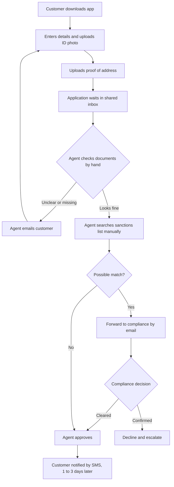
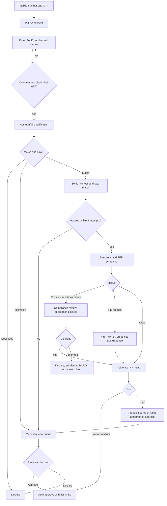
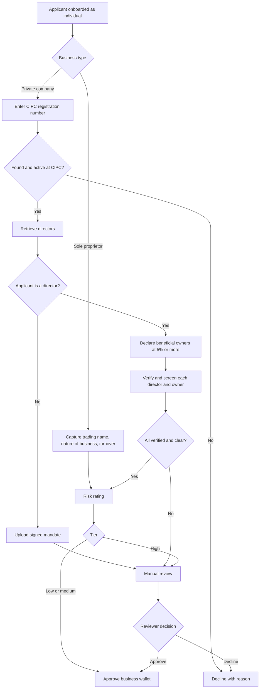

# Process Maps

GitHub renders the diagrams below directly.

## Current State: Individual Onboarding

### Pain Points

| # | Step | Problem | Effect |
| --- | --- | --- | --- |
| P1 | Proof of address | Requested from everyone, although many customers have none in their own name | Largest single drop off point |
| P2 | Shared inbox | No queue order, no service levels | Waits of 1 to 3 days |
| P3 | Manual document check | ID photo checked by eye, not against Home Affairs | Fraud risk, inconsistent decisions |
| P4 | Manual sanctions search | Name only search, no audit trail | Compliance risk, misses on spelling variants |
| P5 | Email loops | Customer has no status visibility | Support calls, abandonment |

## Future State: Individual Onboarding

Checks run cheapest first (format check, then Home Affairs, then liveness, then screening), so paid vendor calls are not spent on applications that would fail earlier.

## Future State: Business Onboarding

## Roles (Swimlane View)

| Step | Customer | System | Vendor | Operations | Compliance |
| --- | :---: | :---: | :---: | :---: | :---: |
| Enter details and consent | X | | | | |
| Format checks | | X | | | |
| Home Affairs verification | | X | X | | |
| Liveness and face match | X | X | X | | |
| Sanctions and PEP screening | | X | X | | |
| Possible sanctions match | | | | | X |
| Risk rating and limits | | X | | | |
| Manual review | | | | X | |
| Enhanced due diligence approval | | | | | X |
